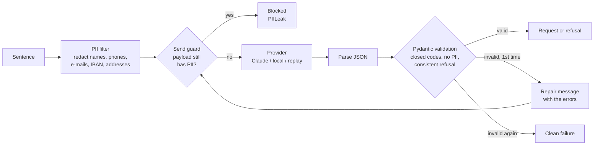

# llm-structured-requests

An accountant types one sentence, such as *"Constitution d'une SARL-S, il me faut les pièces
habituelles"*. A language model turns it into a structured request for the client: a title,
a delay, and the list of documents to send, with a short note for each one.

The code is the easy part. The work is in making the output safe to use:

- **Strict output.** The model must return one JSON object that passes a Pydantic schema.
  If it doesn't, it gets one repair attempt with the validation errors. If that fails too,
  the pipeline returns a clean failure and does not guess.
- **Closed list of documents.** The model picks codes from a fixed catalog of 30 documents.
  It cannot invent one: a code outside the list is rejected, so it never reaches the client.
- **Refusals.** Small talk, other tasks and prompt-injection attempts are refused
  (`off_topic`). Sentences too vague to act on are refused too (`too_vague`).
- **No personal data sent to the model.** Names, phone numbers, e-mails, IBANs, ID numbers
  and addresses are removed before the call. A second check then inspects the actual
  outgoing payload and blocks the call if anything is still there.
- **Swappable providers.** Claude (only if you set an API key), a small open model
  run locally with `transformers` (no key needed), and a replay provider that re-serves
  recorded answers so tests and scoring run offline.

This is inspired by a system I built for an accounting firm in Luxembourg. The code here
is new, and the catalog, sentences, names and numbers are all made up for this repository.

## How it works



| File | Role |
|---|---|
| [structreq/data/catalog.yml](structreq/data/catalog.yml) | The 30 document codes (labels in EN/FR/DE) and the usual set for each of 8 procedures |
| [structreq/schema.py](structreq/schema.py) | The output contract (Pydantic), plus the same contract as a JSON Schema for constrained decoding |
| [structreq/pii.py](structreq/pii.py) | Personal-data detection and redaction (regular expressions, courtesy titles, a first-name list) |
| [structreq/pipeline.py](structreq/pipeline.py) | Redact, guard, call, validate, repair once |
| [structreq/providers/](structreq/providers/) | `claude.py`, `local_hf.py`, `replay.py` |
| [bench/cases.yml](bench/cases.yml) | 60 sentences (24 FR, 18 EN, 18 DE) with the expected request |
| [bench/run.py](bench/run.py) | Runs the benchmark and writes `results.md` |
| [scripts/mutation_check.py](scripts/mutation_check.py) | Breaks each guard on purpose and checks that the tests catch it |

## Results

Measured by `python -m bench.run` on 60 invented sentences: 46 real requests (10 of them
with personal data to filter) and 14 that must be refused (off-topic, prompt injection,
or too vague). This table is regenerated by the benchmark. Per-case details are in
[results.md](results.md).

<!-- results:start -->
| Provider | Valid 1st try | Valid after repair | Correct refusals | False refusals | Doc precision | Doc recall | Exact sets | PII sent | Latency p50 / p95 |
|---|---|---|---|---|---|---|---|---|---|
| local: Qwen/Qwen2.5-1.5B-Instruct | 41/60 (68%) | 51/60 (85%) | 10/14 (71%) | 5/46 (11%) | 0.90 | 0.53 | 16/46 (35%) | 0 | 23.3 s / 41.5 s |
<!-- results:end -->

What this shows: the 1.5B local model rarely picks a wrong document but often leaves some
out (high precision, low recall). It also misreads some off-topic sentences, and some
sentences still fail after the repair. In every case the guards held: no personal data was
sent, and no code outside the nomenclature reached a validated answer. Those failures are
why the output is checked rather than trusted, and why a stronger model is worth testing
with `--provider claude`.

How the numbers are computed:
- **Valid 1st try / after repair**: the answer passed the full schema (JSON, keys, closed
  codes, no personal data, a consistent refusal) without a repair, or with at most one.
- **Doc precision / recall**: computed over the 46 request cases by comparing the set of codes
  returned with the expected set. A failed or refused case counts as no documents returned.
- **PII sent**: the number of times a name, number or address from the sentence appears in
  any payload actually sent to the model, repair turns included.
- **Latency**: wall time per sentence, including the repair if there is one. Measured on a
  GTX 1650 (4 GB) shared with other jobs, fp16, greedy decoding.

Claude was **not** measured: no API key was used while building this repository. You can
run it yourself (see below). Those answers come through Claude's structured outputs
(constrained decoding against the JSON Schema), so they are also re-validated by Pydantic.

### The guards are tested by mutation

`python scripts/mutation_check.py` breaks each guard on purpose: it disables the
closed-list check, disables the PII check on answers, breaks the phone pattern, removes the
first-name rule, removes the send guard, and lets repair run more than once. For each
change it checks that the test suite turns red, then restores the file from a backup copy
and compares it byte for byte. The output is in [mutation.md](mutation.md).

## Run it

Requires Python 3.12 and [uv](https://github.com/astral-sh/uv). The default local model is
`Qwen/Qwen2.5-1.5B-Instruct` (Apache-2.0, about 3 GB, pinned to a commit hash). It is
downloaded on first use and runs on a 4 GB GPU in fp16, or on the CPU, more slowly.

```bash
./run.sh setup                       # create .venv and install pinned dependencies
./run.sh test                        # unit tests, no model needed (uses recorded answers)
./run.sh mutation                    # mutation check of the guards
./run.sh try "Déclaration TVA du T3, pièces habituelles, sous 15 jours"
./run.sh serve                       # http://127.0.0.1:8000, a minimal page to try it
./run.sh bench --provider local --record          # measure the local model
./run.sh bench --provider replay --replay-file bench/replays/local-Qwen_Qwen2.5-1.5B-Instruct.jsonl
```

With Claude (optional, billed to your key):

```bash
uv pip install --python .venv/bin/python -r requirements-claude.txt
export ANTHROPIC_API_KEY=...
./run.sh try --provider claude "Gründung einer SARL-S, bitte die üblichen Unterlagen"
./run.sh bench --provider claude      # model: claude-haiku-5-5, override with --model
```

## Limits

- **The PII filter is rule-based.** It catches names that follow a courtesy title
  (M., Mme, Mr, Herr, Frau...) or start with a first name on its list, plus contact
  details and identifiers. A surname written alone ("ask Weber") or a first name missing
  from the list gets through to the model. The send guard uses the same rules, so it
  can't catch what the filter misses. A production version should add a NER model, and
  the safest approach is still to send no free text you don't need. The same person wrote
  the benchmark sentences and the filter, so the 0-leak figure is optimistic.
- **60 sentences is a small benchmark.** It is enough to compare providers and catch
  regressions, not to estimate real-world accuracy. Each sentence is one short line,
  which is easier than real messages.
- **The 1.5B local model is weak at this task.** It is here to show the pipeline running
  and being measured with no API key. The validation layer is what keeps its mistakes from
  reaching a client. A larger model would do better, but it does not fit the 4 GB GPU this
  was built on.
- **The "usual documents" per procedure are a simplified example**, not legal advice on
  what a Luxembourg company formation requires.
- The web page is a local demo: there is no authentication, and it binds to 127.0.0.1 only.

## License

MIT, see [LICENSE](LICENSE). Third-party models keep their own licenses.
